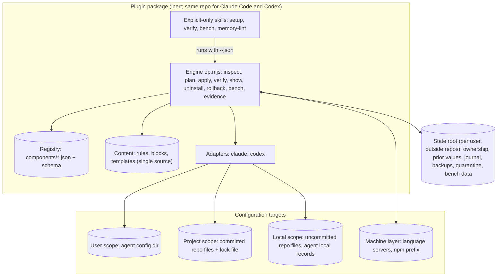

# 05. Architecture

Status: draft for review, 2026-11-01. Decisions are recorded in [12-decision-records.md](12-decision-records.md) (ADR numbers in brackets). Per-agent paths and scope mechanics are in [07-install-scopes.md](07-install-scopes.md).

## In one paragraph

v8 is a desired-state configuration tool for coding agents. A deterministic engine (`ep`, Node 22+, no dependencies) inspects the machine, computes a plan from an evidence registry and the user's answers, applies only the approved rows with a journal, verifies the result and can undo it per scope [ADR-0001]. The agent's role shrinks to what needs judgment: explaining the plan, collecting consent, confirming the project's command map, and writing a short report. The plugin itself is inert (no hooks, MCP servers, network or always-loaded text) and its skills are explicit-only, so installing it costs nothing per session [ADR-0002]. Everything the engine can install is described as data in the registry, with dated evidence and kill tests [ADR-0004], and the bench measures whether a configuration helps on the user's own tasks [ADR-0005].

## Components



| Component | Responsibility | Notes |
| --- | --- | --- |
| Skills (`skills/`, `codex-skills/`) | Conversation only: ask scope, show the plan, collect consent, confirm the command map, report | `disable-model-invocation: true` in Claude Code; `allow_implicit_invocation: false` in Codex. Each is under 60 lines. |
| Engine (`engine/`) | All file-system and configuration work, deterministic, `--json` on every command | Modules in [06-design.md](06-design.md). |
| Registry (`registry/`) | One JSON file per component: roles, verdict, evidence, platforms, egress, request-path effect, install mappings, revisit triggers | Renders `docs/decisions.md`, the successor of Part 2 [ADR-0004]. |
| Content (`content/`) | Owned text, written once: user rules, project blocks, command-map template, compact instructions | Rendered per agent by adapters [ADR-0007]. |
| Adapters (`engine/adapters/`) | Map abstract items (rules block, setting, plugin enablement, skill) to concrete paths and keys per agent and scope | Claude Code in v8.0, Codex in v8.1. |
| State root | Per-user records the engine needs to upgrade, verify and undo | `%LOCALAPPDATA%\efficiency-playbook\`, `$XDG_STATE_HOME/efficiency-playbook/` or `~/Library/Application Support/efficiency-playbook/`; override with `EP_STATE_DIR`. Never inside a repo or a cloud-synced folder. |
| Project lock (`.efficiency-playbook.json`) | Desired state of a `project` install: engine version, agents, component ids and options, recommended component ids | Committed by the user. Contains no paths, user data or machine-specific values, so it is identical on every machine [S-4]. Its one hash covers the confirmed command map, which renders the same everywhere [S-7]. |
| Machine layer | Tools and installs several scopes share (language servers, npm prefix fix, plugin installs in the per-user cache) | Reference-counted per scope in `machine.json` in the state root [S-6]. |

## Main flow: setup

```mermaid
sequenceDiagram
  actor U as User
  participant A as Agent + setup skill
  participant E as ep engine
  U->>A: /efficiency-playbook:setup
  A->>U: Scope? All projects / This project, team / This project, just me
  A->>E: ep inspect --json
  E-->>A: facts (agent, versions, configs, conflicts, policy, v7 artifacts)
  A->>E: ep plan --scope s --answers a.json --json
  E-->>A: plan rows + plan hash
  A->>U: plan table (evidence badges, token costs, egress) + consent questions
  U->>A: approves rows
  A->>E: ep apply --plan <hash> --approve <ids> --json
  E-->>A: journal (applied, skipped, stale, blocked)
  A->>E: ep verify --scope s --json
  E-->>A: findings
  A->>U: report, at most 15 lines; git status and add list for project scope
```

The engine refuses an `apply` whose plan hash doesn't match a plan it computed from the current state (L-8), so the model can't widen or alter what the user approved.

## Key decisions and why

| Decision | Rationale | ADR |
| --- | --- | --- |
| Deterministic engine; model at the edges | v7's 700-line prose program costs tokens on every run and can be executed differently each time, or steered by injected text. Desired-state tools (Terraform, chezmoi, Nix home-manager) solve exactly plan, apply and undo. | 0001 |
| Plugin-native packaging, inert plugin | Skills live in the plugin, so enabling or disabling the plugin per scope is the native switch; explicit-only skills cost no listing tokens; no hooks keeps sessions unchanged until the user opts in. | 0002 |
| Three scopes mapped to native agent scopes | The user picks all projects, team project or personal project; each item is written at the scope chosen for it. Instructions from all scopes load together in both agents, so the engine never places a fragment twice within a scope, never repeats a `user` or `project` item at `local`, and reports, with their token cost, the two duplicates it can't avoid: a self-contained project file plus the user install, and the Codex block in `AGENTS.md` when Claude Code also reads it. Claude Code text goes only into owned files under `rules/`, never into `CLAUDE.md`, so a repository's `AGENTS.md` keeps loading (07, section 3.3). | 0003 |
| Registry as data, generated decisions page | Verdicts and evidence change weekly; data can be validated, diffed, aged and rendered; prose can't. | 0004 |
| Personal bench as the promotion gate | Harness effects depend on model and task mix; the user's own history is the relevant test set. | 0005 |
| Hard budget for always-loaded text | Context added to every session must pay for itself; a CI gate keeps it from creeping. | 0006 |
| Single source of content, per-agent adapters | One text, rendered for Claude Code and Codex, so copies never drift. | 0007 |
| Node 22+, zero dependencies, three-OS CI | Node is already a prerequisite of the language-server setup; zero dependencies removes most supply-chain exposure. | 0008 |
| Pinned releases, checksums, attestations, consent for third-party upgrades | The tool changes what code agents run; its own supply chain must be inspectable. | 0009 |
| Nothing committed or pushed; no hooks, MCP servers or permission rules at project scope | Committed configuration runs on teammates' machines; only the agents' own trust and install prompts may enable code there. Components with hooks, per-user state, `env` entries or machine tools are only recommended by the lock, for each person to enable at `local` or `user`. | 0010 |

## Quality-attribute scenarios

| Attribute | Scenario | How the architecture meets it |
| --- | --- | --- |
| Task quality | A component is proposed for Adopt | Registry requires evidence with quality measured; bench decision rule requires non-inferiority on pass rate. |
| Cost | A new rule is added to `content/` | CI budget gate fails if the always-loaded estimate exceeds the scope budget. |
| Reversibility | User uninstalls the project scope a month later after editing the rules block | Engine restores keys from prior values, removes unchanged owned items, shows a diff for the edited block and asks. |
| Reproducibility | Two teammates run setup from the same lock | Adapters render identical committed bytes; only machine-layer installs differ, and those are listed. |
| Maintainability | Claude Code ships a release that renames a setting | Weekly CI against the latest agent CLIs fails a fixture test; the maintainer updates one adapter mapping and the registry's tested version. |

## What is deliberately not here

No proxy, gateway or model router in the request path; no hosted service or telemetry; no background daemon; no automatic verdict changes; no automatic commits. A self-tuning loop over the Pareto front is an Assess item for v8.3+ (see the ledger), not part of the core.
