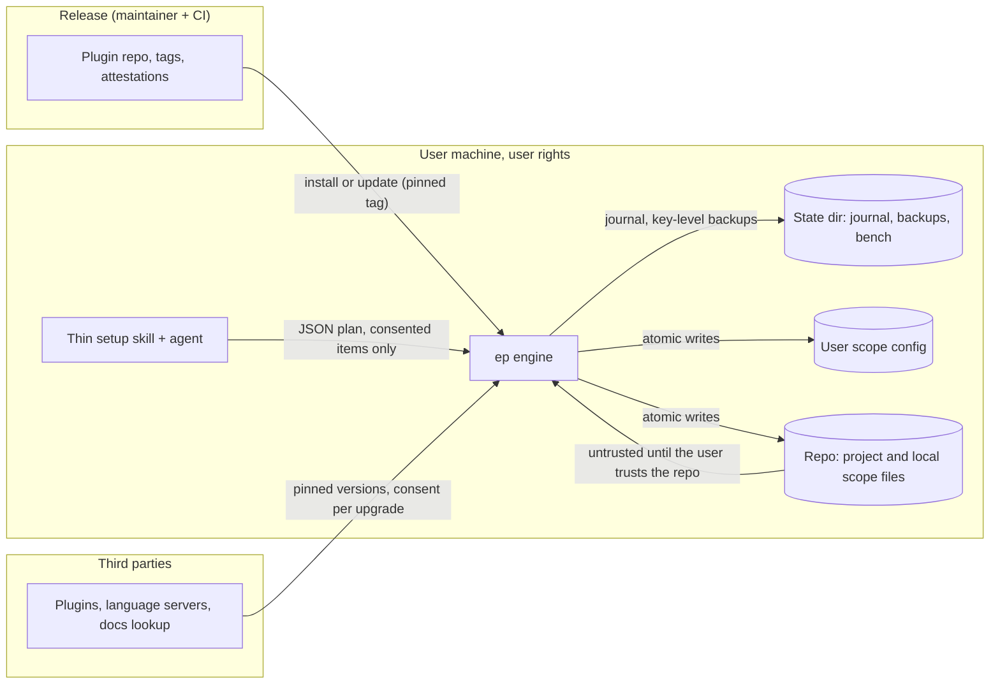

# 10. Threat model

Status: draft for review, 2026-11-01. Method: assets, trust boundaries, then threats by STRIDE category, each with a mitigation, the residual risk and the requirement that tests it ([04-requirements.md](04-requirements.md)). This tool runs with the user's full rights on machines where, on native Windows, agent shell commands are not sandboxed, so the bar is "never make the user's machine less safe than before install".

## Assets

| Asset | Why it matters |
| --- | --- |
| A1. Agent configuration (settings, instructions, plugins, hooks, MCP servers) in every scope | Controls what code the agent runs and what it sends where |
| A2. Credentials (agent OAuth tokens, API keys, git and cloud credentials, tokens inside `env` blocks) | Account takeover, billing abuse |
| A3. Source code and transcripts | Confidential; third-party egress is a hard "no" by default |
| A4. Teammates' machines (through committed project configuration) | A committed change runs on every machine that opens the repo |
| A5. Engine state: lock file, journal, backups, bench data | Drives uninstall and restore; holds prior values and transcripts |
| A6. The release itself (plugin, engine, registry) | Everyone who updates runs it |

## Trust boundaries

Boundaries that matter most: release to machine (B1), committed repo content to engine (B2), engine to third-party components (B3), LLM to engine (B4: the model proposes, the engine validates and acts).

## Threats

| ID | STRIDE | Threat | Mitigation | Residual risk | Tests |
| --- | --- | --- | --- | --- | --- |
| T1 | Tampering | A compromised release (account takeover, malicious pull request) ships a hostile engine. | Zero runtime dependencies; release only from CI on a protected tag; SHA256SUMS plus GitHub artifact attestations on release assets; README recommends a pinned install (`#v8.x.y`); a plugin update never runs the engine by itself, the user runs setup. `ep verify --self` compares installed files with the release checksums. | Self-verification detects corruption and accidental drift, not an attacker who controls the release. Stated plainly in the README. | N-10, release checklist (08) |
| T2 | Tampering | A third-party component (plugin, language server) publishes a hostile update. | Registry records the tested version; installs use pinned versions where the mechanism allows; any version change is a new plan row needing consent; `verify` reports unexpected versions. The engine does not enable auto-update for third-party marketplaces. | Agents may auto-update some marketplaces by their own policy (see 07); the engine reports, it can't block. | C-1, L-9 |
| T3 | Elevation | Hooks run arbitrary commands on every session event; a committed hook runs on teammates' machines. | No hooks by default. The optional nudge hook is user scope only, a fixed script whose hash `verify` checks. Never hooks at `project` scope. | A user can still add their own hooks; out of scope. | S-10, U-3 |
| T4 | Spoofing, Tampering | A cloned, untrusted repo carries a crafted lock file or settings to make the engine install things or run commands. | Project files are data. The lock file can only name registry component ids (to enable or to recommend), option values from their schemas and content hashes: no commands, URLs or paths. Components that run hooks, keep per-user state, need `env` or need a machine tool can only be recommended; each person enables them at `local` or `user` scope through their own plan. The first apply from a lock the engine didn't write on this machine asks "Trust this repository's configuration?" and shows every row. | A user who trusts a hostile repo gets what its lock lists, but only registry components. | S-10, I5 below |
| T5 | Tampering | Prompt injection: text in files, web pages or tool output steers the LLM that runs setup (v7's main exposure, since the model executed 700 lines of prose). | The model never decides paths, keys or commands; it explains the engine's plan and relays consent. The engine validates every request against the plan and schemas. Evidence research is a maintainer task, and retrieved content is data. | The model could misreport a plan; the engine prints its own plan table too. | L-2, L-3 |
| T6 | Information disclosure | Backups or bench artifacts copy secrets (tokens in `env`, transcripts with code). | Key-level prior values for JSON and TOML, kept in state.json, plus one whole copy of each settings file before its first edit in an apply, for restoring by hand. Other whole-file backups only for files the engine fully owns. Nothing outside the scope's path set is copied, so credential files never are. State dirs are user-only; retention is bounded (L-10, not built in 8.0); bench export is explicit. | Bench transcripts can contain whatever the agent saw; kept local. A settings copy holds whatever its `env` held, in the user-only state folder, until the user removes it. | L-10, M-7, N-7 |
| T7 | Information disclosure | A recommended component sends code, prompts or telemetry to a third party. | Registry `egress` field; Adopt requires no default egress except the docs-lookup exception; `verify` flags installed components with known egress. | Unknown egress in a third-party update; reported once known. | C-5 |
| T8 | Tampering | A tampered lock or state makes uninstall delete user files (for example listing `~/.ssh/id_ed25519` as owned). | Uninstall deletes only paths inside the scope's allowed path set and only when the current hash equals the owned hash (recorded in state, or derived from the lock at `project` scope). Deletions move to a quarantine folder in state, not a hard delete. | None known beyond disk usage. | L-5, I1, I2 |
| T9 | Denial of service | A partial or invalid write breaks agent startup (corrupt settings file). | Temp file plus rename; parse-after-write; journaled revert; `verify` after every apply; revert on parse failure. | Agent schema changes can still reject a valid file; caught by weekly CI against latest agent CLIs. | L-7, N-10 |
| T10 | Repudiation | No record of what changed and who approved it. | Journal per apply: plan hash, approved row ids, before and after hashes, engine version. | None. | L-2 |
| T11 | Elevation | The agent or bench runs repo commands with full user rights (native Windows has no shell sandbox). | The engine never runs agent-chosen commands. Bench runs only the prepare and acceptance commands it listed and the user accepted by typing that listing's code, in a scratch clone. Docs recommend WSL or a dev container for untrusted repos. | Bench is not a sandbox; stated in its help text. | M-1, M-4 |
| T12 | Spoofing | Users install a fork or typosquat marketplace. | README names the canonical repo; `verify` checks that the registered marketplace source for this plugin is the canonical one and warns otherwise. | Users who ignore the warning. | L-9 |
| T13 | Elevation | The engine works around organization policy. | Managed settings are read-only inputs; blocked items are shown as "blocked by policy" and never retried another way. | None intended. | U-4 |
| T14 | Tampering | CI supply chain (third-party actions). | Pin actions by commit SHA in release jobs; least-privilege `permissions`; release job needs `check` and `selftest`. | GitHub platform compromise. | Release checklist |
| T15 | Tampering, Elevation | Malware persists through agent configuration: worms write SessionStart hooks into repository `.claude/settings.json`, MCP servers into agent configs and `mcpServers` entries into `~/.claude.json` (Miasma, June 2026: SessionStart hooks in `.claude/settings.json` and `.gemini/settings.json` of at least 123 repositories, per SafeDep's analysis; no NVD or GitHub advisory found). A configuration tool that rewrites files can hide such entries. | `verify` lists every hook, MCP server, `env` entry and mod at every scope that v8 doesn't own (`EP-UNOWNED-EXECUTABLE-CONFIG`) and says which appeared since the last verify. The engine never approves, re-trusts, reorders or reformats entries it doesn't own. | Detection only, and only when `verify` runs; malware running as the user can also edit v8 state. | U-5, S-10 |
| T16 | Elevation | On a vulnerable agent version, a crafted plugin installed or auto-updated from a git host that allows SHA-shaped branch names can run code with no further click (CVE-2026-86063, which its reporters call Plugin4Shell, fixed in Claude Code 2.1.179 per advisory GHSA-pq7j-f95f-qfcv; Codex 0.146.0 added verification of Git plugin SHA checkouts and 0.165.0 closed a marketplace URL validation gap). | The registry records a minimum version per agent and surface; `EP-AGENT-BELOW-MIN` blocks plugin and marketplace rows on older agents and names the update to install. | Unknown future flaws; the weekly agent CI job tracks security releases. | A-5 |
| T17 | Elevation | Headless Claude Code runs (`claude -p`, the Agent SDK) skip the trust dialog and count it as accepted, so when the bench runs a repository, its settings hooks, `env` entries, helper commands and MCP servers execute without a prompt. Codex loads a project's `.codex/` layers only when the project is trusted, and hooks that aren't managed need review unless `--dangerously-bypass-hook-trust` is passed; whether `codex exec` does the same is unverified (07 section 13). | Before every run the bench lists the project and arm configuration that will execute or apply, and goes on only when the user types back that listing's fresh code at a terminal. Nothing is remembered, it refuses inside agent sessions, and a configuration change after the code is typed stops the run (`EP-BENCH-CONFIG-CHANGED`); identical strict MCP configuration in every arm; scratch clones. | A user who accepts a hostile listing; an agent that drives a pseudo-terminal can type the code itself. | M-9 |
| T18 | Elevation | Claude Code mods (since v2.1.287) run unsandboxed, above hooks and permission rules, also in `-p` runs; a mod can approve calls past `ask` rules (when there are no managed settings and no Team or Enterprise login) or rewrite merged settings. | v8 ships no mod (Reject in 03). `verify` reports installed mods (`EP-MOD-PRESENT`) and bench fingerprints include them; a verify pass on a machine with third-party mods says that a mod can change what the agent actually does. | v8 can't vouch for a configuration that includes third-party mods. | 06 §9 |
| T19 | Tampering | Codex checks every Git marketplace at startup and force-reinstalls its plugins when the revision changed, so an unpinned install takes every push to `main` (Codex 0.166.0 source). | Every release is tagged; docs and setup install Codex with `--ref vX.Y.Z`; `verify` flags an unpinned marketplace entry for this plugin; release tags are protected. | A moved tag, covered by tag protection and the release checklist. | L-9 |
| T20 | Tampering | Skills in a repository load without trust in Codex (`.agents/skills` from the working directory up to the root, and `.codex/skills` even in untrusted projects), and `~/.agents/skills` is read by other agents too; the Agent Skills format has no explicit-only field, so an agent whose own flag v8 doesn't set may load those skills automatically. | v8 never installs skills into any `.agents/skills` folder; its skills ship inside the plugins with explicit-only flags, and migration removes v7.4's copies. `verify` reports repository skills in projects that aren't trusted as unowned configuration. | Agent behavior v8 can't change. | U-5 |

## Invariants the test suite enforces

- I1. Writes stay inside the allowed path set of the chosen scope, plus the engine state dir.
- I2. No deletion of a file whose hash differs from the owned hash (recorded in state, or derived from the lock at `project` scope) without per-item consent; deletions go to quarantine.
- I3. Network use is limited to the agent CLIs and package managers the plan names, at pinned versions, after consent. `ep evidence fresh` (maintainer only) is the one other network command.
- I4. The engine never opens these paths: `~/.claude/.credentials.json`, `~/.claude.json` and its backups, `~/.codex/auth.json`, `~/.ssh/`, `~/.aws/`, `~/.git-credentials`, `~/.config/gh/hosts.yml`, `~/.npmrc`, any `.env*` file. What the agent records about plugins and marketplaces comes from its CLI and the files under its `plugins/` folder.
- I5. A project lock file can hold only the engine version, agent names, registry component ids (under `components` or `recommended`), schema-valid option values and content hashes. A component that runs hooks, keeps per-user state, needs `env` or needs a machine tool appears only under `recommended`.
- I6. At `project` scope the engine writes only the project rules file, the project block in `AGENTS.md`, marketplace and plugin enablement for plugins allowed there, and `.efficiency-playbook.json`: no hooks, MCP servers, permission rules, `env` entries, or keys whose effect reaches past the project (one repository's `cleanupPeriodDays` deleted transcripts for every project on the machine: CC#90148).
- I7. The engine never writes endpoint or credential settings at any scope: `ANTHROPIC_BASE_URL`, `ANTHROPIC_API_KEY`, `apiKeyHelper`, `OPENAI_BASE_URL`, Codex provider and base-URL keys, or an `env` entry holding a key or token. Someone else's endpoint setting at project scope is reported, because a project-level `ANTHROPIC_BASE_URL` was enough to send a user's API key to another host (CVE-2026-21852, fixed in Claude Code 2.0.65).

## Hooks are not a security boundary

Nothing in v8 relies on a hook for safety. By default a hook that fails lets the action proceed (`onFailure` defaults to `continue`; `block` needs 2.1.295 or later). Prompt and agent hooks have concurrency caps rather than drop limits: at most 12 of one event run at once (2.1.302) and 24 per session, subagents included (2.1.312); the rest wait. One skill source can register at most 1,024 hooks per session (2.1.304). Output over 10,000 characters goes to a file with a 2,000-character preview, some surfaces may not run hooks (inferred), and mods can override them. On Windows, Claude Code runs command hooks through Git Bash (PowerShell only when Git Bash is absent) and ignores the `commandWindows` field that Codex uses (issue #90122, open). The optional nudge hook is a convenience. v8's guarantees come from the engine's plan, consent, journal and the invariants above.

## Not defended

A malicious maintainer with release rights, a compromised agent binary or Node runtime, and malware already running as the user. The engine reduces exposure; it is not a sandbox or an endpoint protection tool.
